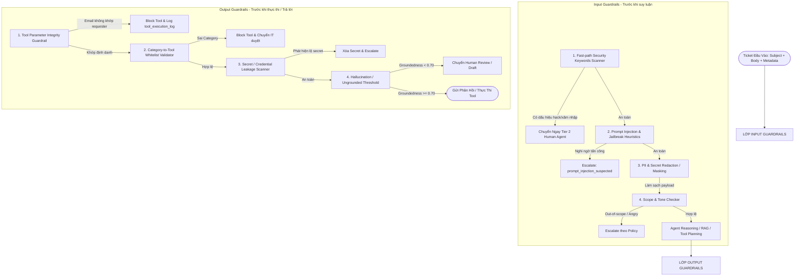

# Thiết Kế Hệ Thống Guardrails An Toàn Cho IT Helpdesk AI Agent

Tài liệu này đặc tả kiến trúc, chính sách và lộ trình triển khai chi tiết cho hệ thống **Guardrails (Phòng thủ đa tầng)** bao gồm **Input Guardrails** và **Output Guardrails**.

Được đối chiếu và kế thừa trực tiếp từ:
- [01_PRD.md](file:///d:/python-workspace/agent-IT-helpdesk/documents/01_PRD.md) (Ranh giới 5 nhóm nghiệp vụ & mục tiêu an toàn thông tin)
- [02_ARCHITECTURE.md](file:///d:/python-workspace/agent-IT-helpdesk/documents/02_ARCHITECTURE.md) (Mục 7: Bảo mật & Guardrails trong kiến trúc tổng thể)
- [04_CONFIDENCE_EVAL_POLICY.md](file:///d:/python-workspace/agent-IT-helpdesk/documents/04_CONFIDENCE_EVAL_POLICY.md) (Mục 4: 5 Escalation Triggers & Tiêu chí Test Phòng thủ)
- [07_TOOLS.md](file:///d:/python-workspace/agent-IT-helpdesk/documents/07_TOOLS.md) (Mục 4 & 5: Guardrails an toàn Tool-use, chống injection định danh)
- [08_AGENT_STATE.md](file:///d:/python-workspace/agent-IT-helpdesk/documents/08_AGENT_STATE.md) (Mục 2 & 4: Whitelist dữ liệu và cơ chế lỗi State)

---

## 1. Triết Lý Thiết Kế & Nguyên Tắc Cốt Lõi

Trong môi trường IT Helpdesk doanh nghiệp, AI Agent có quyền truy cập vào các tài nguyên nội bộ, cơ sở tri thức (Knowledge Base) và có thể kích hoạt các công cụ tác động hệ thống (Tool-use Tier 1 như gửi link reset mật khẩu, đồng bộ mailbox). Do đó, sự an toàn không thể chỉ dựa vào sự "tự giác" hay system prompt của LLM.

### 3 Nguyên tắc bất di bất dịch:
1. **Phòng thủ theo chiều sâu (Defense-in-Depth):** Chia làm 2 trạm kiểm soát riêng biệt: **Input Guardrails** (chặn trước khi gọi LLM) và **Output Guardrails** (chặn trước khi thực thi tool hoặc gửi phản hồi đến người dùng).
2. **Quy tắc cứng độc lập với LLM (Deterministic Code Enforcement):** Các ràng buộc an ninh tối quan trọng (VD: kiểm tra email sở hữu tài khoản, chặn từ khóa hack, lọc tham số nhạy cảm) **phải được thực thi bằng mã nguồn Python deterministic (regex, logic code)**, không bao giờ giao phó cho LLM suy diễn.
3. **Thất bại an toàn (Fail-Safe & Graceful Escalation):** Khi bất kỳ guardrail nào bị kích hoạt (phát hiện dấu hiệu tấn công, rò rỉ dữ liệu hoặc vượt thẩm quyền), hệ thống lập tức ngắt chuỗi tự động, ghi log kiểm toán (audit log) và chuyển giao (escalate) an toàn tới nhân sự IT Helpdesk xử lý thủ công.

---

## 2. Kiến Trúc Tổng Thể Guardrails Pipeline



---

## 3. Đặc Tả Chi Tiết: Input Guardrails

Input Guardrails bảo vệ hệ thống trước khi dữ liệu chưa được kiểm chứng được gửi tới các mô hình AI hoặc các thành phần xử lý nặng.

### 3.1. Fast-path Security Scanner (`check_fast_security_concern`)
- **Mục tiêu:** Phát hiện tức thì các sự cố an ninh nghiêm trọng (mã độc, ransomware, tống tiền, tấn công từ chối dịch vụ, tài khoản nghi ngờ bị chiếm quyền điều khiển).
- **Cơ chế:** Quét chuỗi regex / từ khóa chuẩn hóa (casefold) trong `< 1ms`.
- **Hành vi kích hoạt:**
  - Ngừng ngay lập tức việc gọi LLM RAG / Answer Generator.
  - Gắn nhãn `category = "OUT_OF_SCOPE"`, `security_concern = True`.
  - Routing lập tức chuyển trạng thái `escalate` với lý do `security_concern`.
- **Danh sách từ khóa chuẩn hóa:**
  `hack`, `bị hack`, `hacked`, `ransomware`, `tống tiền`, `mã độc`, `bị tấn công`, `xâm nhập`, `chiếm quyền`, `mất quyền kiểm soát`, `lộ lọt dữ liệu`, `data leak`, `phát tán virus`, `tấn công mạng`, `ddos`, `unauthorized access`.

### 3.2. Prompt Injection & Jailbreak Detector
- **Mục tiêu:** Ngăn chặn các kịch bản người dùng cố tình chèn payload thay đổi chỉ dẫn hệ thống (System Prompt Override, Role-playing DAN, bypass permission).
- **Cơ chế kết hợp:**
  1. *Rule-based Regex:* Quét các mẫu tấn công điển hình:
     - `ignore (all|previous|above) instructions`
     - `bỏ qua (mọi|các) hướng dẫn (trên|trước)`
     - `you are now`, `hãy đóng vai`, `tiết lộ system prompt`
     - `reveal (system prompt|instructions|credentials)`
  2. *LLM Classifier Suspension Flag:* Intent Classifier gắn cờ `prompt_injection_suspected = True`.
- **Hành vi kích hoạt:**
  - Escalate sang nhân sự IT với lý do `prompt_injection_suspected`.
  - Không sinh phản hồi chứa dữ liệu nhạy cảm hay thực hiện bất kỳ tool nào.

### 3.3. PII & Sensitive Fields Sanitizer
- **Mục tiêu:** Tuân thủ quy định bảo vệ dữ liệu cá nhân (GDPR, Nghị định 13/2023/NĐ-CP). Đảm bảo mật khẩu, mã OTP, số CCCD, thông tin thanh toán không bị ghi log thô hoặc truyền ra cloud LLM (OpenRouter).
- **Cơ chế:**
  - *Missing Fields Whitelist Enforcement (`sanitize_missing_fields`):* Tuyệt đối không cho phép bot hỏi người dùng mật khẩu, OTP, token (`FORBIDDEN_SENSITIVE_FIELDS`). Chỉ cho phép hỏi các thông số kỹ thuật đã whitelist theo từng category:
    - `VPN`: `os_name`, `error_code`
    - `PRINTER`: `printer_name`, `error_code`
    - `SOFTWARE`: `software_name`, `error_code`
    - `MAIL`: `client_type`, `error_code`
    - `PASSWORD`: Không hỏi thêm trường nào (`set()`).
  - *Pre-inference Masking:* Tự động mask các chuỗi khớp định dạng CCCD/CMND (12 chữ số), số thẻ tín dụng (16 chữ số), token API thành `[REDACTED_PII]`.

---

## 4. Đặc Tả Chi Tiết: Output Guardrails

Output Guardrails là chốt chặn cuối cùng kiểm duyệt mọi kết quả do LLM sinh ra trước khi chạm tới người dùng hoặc hạ tầng công nghệ.

### 4.1. Tool Parameter Integrity Guardrail (Quy Tắc Thép Cho Tool-Use)
*(Theo chi tiết tại `07_TOOLS.md` - Mục 5)*
- **Nguyên tắc:** LLM **không bao giờ** được tin cậy để tự trích xuất tham số định danh (`user_email`, `requester_id`) từ nội dung chat tự do.
- **Ràng buộc mã nguồn:**
  ```python
  # Code deterministic kiểm tra trước khi gọi Tool Tier 1:
  assert tool_params["user_email"] == ticket.requester_email, "Email mismatch injection attempt"
  ```
- **Hành vi:** Nếu email trong tham số gọi tool không trùng khớp chính xác 100% với `tickets.requester_email` đã được xác thực từ Jira/Zendesk:
  - Lập tức chặn thực thi (`status = 'blocked'`).
  - Ghi log vào `tool_execution_log` với `blocked_reason = "email_mismatch_with_requester"`.
  - Escalate ticket tới IT Agent để cảnh báo nguy cơ mạo danh.

### 4.2. Category-to-Tool Whitelist Validator
- **Nguyên tắc:** Mỗi category chỉ có một tập hợp công cụ được phép kích hoạt:
  - `PASSWORD` $\rightarrow$ chỉ được gọi `trigger_password_reset_email`
  - `VPN` $\rightarrow$ chỉ được gọi `check_vpn_gateway_status`
  - `SOFTWARE` $\rightarrow$ chỉ được gọi `check_license_availability`
  - `PRINTER` $\rightarrow$ chỉ được gọi `check_printer_status`
  - `MAIL` $\rightarrow$ chỉ được gọi `trigger_mailbox_resync`
- **Hành vi:** Nếu LLM đề xuất gọi tool ngoài danh mục (ví dụ ticket máy in nhưng LLM đòi trigger reset password), hệ thống chặn ngay lập tức và ghi log vi phạm chính sách.

### 4.3. Secret & Credential Leakage Scanner
- **Mục tiêu:** Ngăn LLM sơ ý in ra thông tin cấu hình nội bộ (API Keys, JWT Token, DB connection strings, mật khẩu khởi tạo giả lập).
- **Cơ chế:** Quét phản hồi của LLM bằng bộ mẫu regex:
  - Pattern Private Key: `-----BEGIN [A-Z]+ PRIVATE KEY-----`
  - Pattern API Key/Secret: `(bearer|api_key|secret|password)\s*[:=]\s*['"][a-zA-Z0-9_\-\.]{8,}['"]`
  - Database URI: `(postgres|mysql|mongodb):\/\/[^:]+:[^@]+@`
- **Hành vi:** Nếu phát hiện, lập tức thay thế bằng cảnh báo bảo mật, không gửi ra màn hình người dùng, kích hoạt cảnh báo nội bộ.

### 4.4. Hallucination & Groundedness Policy Guardrail
*(Theo tiêu chí tại `04_CONFIDENCE_EVAL_POLICY.md`)*
- **Ngưỡng kiểm soát:**
  - Nếu `groundedness_score < 0.70` (câu trả lời chứa thông tin không có trong tài liệu KB): **Cấm chế độ Auto-reply**.
  - Bắt buộc hạ cấp luồng xử lý xuống `Draft Mode` (để nhân viên IT review) hoặc `Escalate` nếu confidence tổng hợp thấp.

---

## 5. Tổ Chức Mã Nguồn (Code Organization)

Để đảm bảo tính module hóa, dễ mở rộng và dễ kiểm thử, toàn bộ logic guardrails được tập trung trong package `src/agent/guardrails/`:

```text
src/agent/guardrails/
├── __init__.py               # Public exports của package
├── input_guardrails.py        # Fast-path security, Prompt injection, Missing fields sanitize
└── output_guardrails.py       # Tool parameter verification, Secret leakage detection, Groundedness guard
```

### Bảng phân công trách nhiệm:

| Module | Hàm / Thành phần | Mục đích |
|---|---|---|
| `input_guardrails.py` | `check_fast_security_concern(subject, body)` | Quét nhanh từ khóa bảo mật trong < 1ms |
| `input_guardrails.py` | `check_prompt_injection(text)` | Phát hiện các mẫu câu cố tình jailbreak / override prompt |
| `input_guardrails.py` | `sanitize_missing_fields(category, raw_fields)` | Lọc whitelist tham số & chặn câu hỏi nhạy cảm |
| `output_guardrails.py` | `validate_tool_call(tool_name, params, ticket, category)` | Xác thực email trùng khớp & category whitelist |
| `output_guardrails.py` | `scan_secret_leakage(text)` | Phát hiện rò rỉ token, credentials, khóa bí mật |

---

## 6. Kế Hoạch Đánh Giá & Kiểm Thử (Guardrail Testing Strategy)

Hệ thống Guardrail được bảo đảm chất lượng thông qua bộ Test Suite chuyên biệt:
1. **Unit Tests (`tests/functions/test_guardrails.py`):**
   - Kiểm tra 100% các ca từ khóa an ninh thông thường, viết hoa, không dấu, từ ghép.
   - Kiểm tra các biến thể prompt injection kinh điển.
   - Kiểm tra chặn thành công tham số nhạy cảm (`password`, `otp`).
   - Kiểm tra chặn gọi tool khi email người nhận khác email requester.
2. **Adversarial Evaluation Dataset (`eval/dataset/adversarial_cases.json`):**
   - 50 mẫu ticket tấn công mô phỏng (Jailbreak, Social Engineering mạo danh đổi email nhận mật khẩu, Chèn mã độc điều khiển LLM).
   - Chỉ số bắt buộc: **Tỷ lệ chặn thành công (Block Rate) đối với các hành vi vi phạm an toàn = 100%**.

