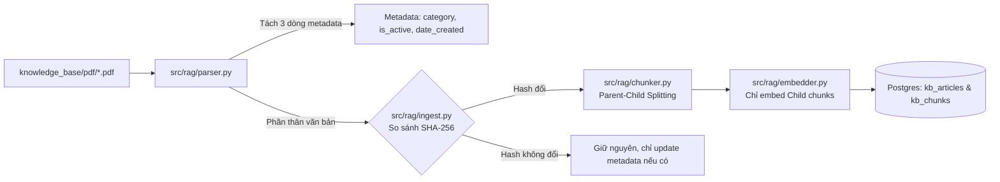
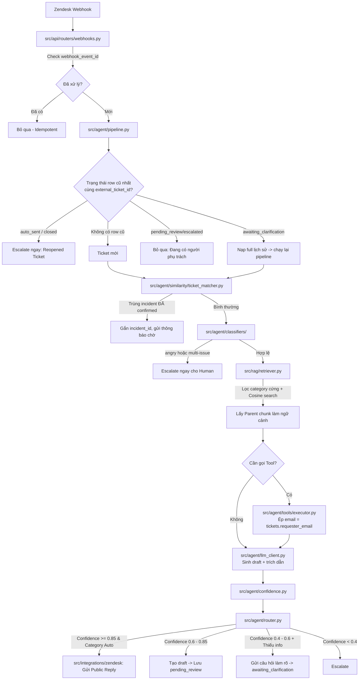
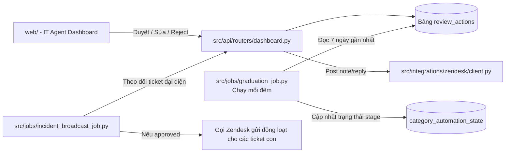

---

## PHẦN 1: Đánh giá cấu trúc thư mục hiện tại

```text
agent-IT-helpdesk/
├── .env, .gitignore, requirements.txt
├── documents/          # 7 tài liệu docs chuẩn hóa rất tốt
├── eval/               # Đang có dataset, results, và 3 script eval_retrieval_*.py
├── knowledge_base/     # Chứa lẫn cả .docx, .pdf, file thử nghiệm
├── src/
│   ├── agent/service/  # Đang trống
│   └── database/       # Chứa migrate.py và ingest_kb.py
└── workflow.md

```

### 1. Ưu điểm hiện tại

* **Tài liệu thiết kế cực kỳ chất lượng:** Thư mục `documents/` đã quy hoạch đầy đủ các bài toán khó (Parent-child retrieval, Category graduation, Incident 2-phase, Tool guardrail, Trạng thái ticket).
* **Đi đúng định hướng Eval-Driven:** Đã hoàn thành hạ tầng ban đầu (`migrate.py`, `ingest_kb.py`) và đang tập trung đo **Retrieval Recall@5** trong `eval/` trước khi đụng vào UI/API, hoàn toàn bám sát `workflow.md`.

### 2. Nhược điểm & Khoảng trống kiến trúc (Gaps)

* **Trộn lẫn tầng Ingestion và tầng Database:** `src/database/` đang gộp cả hạ tầng khởi tạo DB (`migrate.py`) lẫn nghiệp vụ xử lý tài liệu RAG (`ingest_kb.py`). Khi thêm hybrid search, parent-child chunking hay parsing PDF metadata, file này sẽ phình to và khó bảo trì.
* **Thư mục `eval/` bắt đầu bị phân mảnh:** Có cùng lúc `eval_retrieval.py`, `eval_retrieval_first_ver.py`, `eval_retrieval_latest.py`. Cần chuẩn hóa thành một CLI runner hoặc module đo lường nhiều chiều (Retrieval, Answer Generation, Hallucination, Guardrail Injection).
* **`src/agent/` chưa có hình hài phân lớp:** Hệ thống này gồm nhiều sub-engine chạy tuần tự: Intent Classifier, Sentiment Check, Similarity Engine (phục vụ 4 mục đích), Tool Execution (Tier 0 & Tier 1), Confidence Scorer, Routing Policy. Nếu chỉ để `src/agent/service/` sẽ rất dễ biến thành một "god file" ôm đồm toàn bộ.
* **Thiếu các tầng hệ thống quan trọng:**
* **Core / Config:** Chưa có file quản lý biến môi trường tập trung (Pydantic Settings), DB pool và custom exceptions.
* **Integrations:** Chưa có chỗ đặt Zendesk Webhook/API Client, Mock SMTP / Mailbox sync theo `07_TOOLS.md`.
* **Background Jobs:** Chưa có chỗ cho cronjob Category Graduation (`05_CATEGORY_GRADUATION.md`) và Incident Broadcast.
* **Deployment / Hạ tầng:** Chưa có `docker-compose.yml` (Postgres pgvector, Ollama, Redis nếu cần) để đảm bảo tính tái lập.

---

## PHẦN 2: Đề xuất cấu trúc thư mục lý tưởng

Cấu trúc dưới đây áp dụng mô hình **Modular Monolith** kết hợp **Service-Oriented Architecture** chuẩn cho các hệ thống AI Agent Production:

```text
agent-IT-helpdesk/
├── docker/                             # Dockerfile và compose cho local/VPS
│   ├── docker-compose.yml              # Postgres + pgvector, Redis (tùy chọn)
│   └── Dockerfile
├── documents/                          # Giữ nguyên 7 tài liệu thiết kế đặc tả
├── knowledge_base/                     # File tài liệu KB nguồn chuẩn
│   ├── raw_docs/                       # Nơi lưu file .docx gốc (nguồn soạn thảo)
│   └── pdf/                            # File .pdf đã chuẩn hóa 3 dòng metadata đầu
├── eval/                               # Evaluation Framework & Benchmark
│   ├── dataset/
│   │   ├── golden_dataset.json         # Dataset chuẩn (100-150 sample)
│   │   └── adversarial_dataset.json    # Test prompt injection, multi-issue, v.v.
│   ├── harness/                        # Code chạy đánh giá tự động
│   │   ├── eval_retrieval.py           # Đo Recall@5, MRR (gộp các bản cũ)
│   │   ├── eval_generation.py          # Đo Accuracy, Hallucination qua LLM-as-judge
│   │   └── eval_guardrails.py          # Test tool guardrails & escalation triggers
│   └── results/                        # Báo cáo CSV, Markdown kết quả theo timestamp
├── src/
│   ├── core/                           # Cấu hình chung và hạ tầng nền
│   │   ├── __init__.py
│   │   ├── config.py                   # Pydantic BaseSettings đọc .env
│   │   ├── database.py                 # Connection pool, session maker cho Postgres
│   │   └── logging.py                  # Format log có tracing theo ticket_id
│   │
│   ├── database/                       # Quản lý cấu trúc CSDL & Seed
│   │   ├── migrations/                 # Các file SQL hoặc script migration
│   │   │   └── 001_init_schema.sql
│   │   ├── migrate.py                  # Script thực thi migration idempotent
│   │   └── models.py                   # SQLAlchemy models hoặc SQL query helpers
│   │
│   ├── rag/                            # Toàn bộ pipeline RAG (Ingest -> Query)
│   │   ├── __init__.py
│   │   ├── parser.py                   # Parse PDF: tách metadata, lọc content
│   │   ├── chunker.py                  # Chiến lược Parent-Child Chunking
│   │   ├── embedder.py                 # Wrapper gọi bge-small / nomic-embed
│   │   ├── ingest.py                   # Check SHA-256 hash, upsert KB
│   │   └── retriever.py                # Hybrid search: filter category/status + cosine
│   │
│   ├── agent/                          # Bộ não ra quyết định và quy trình AI
│   │   ├── __init__.py
│   │   ├── llm_client.py               # Wrapper kết nối Ollama (Llama 3.2 3B / Qwen 2.5)
│   │   ├── prompts/                    # Quản lý prompt templates tập trung
│   │   │   ├── classify.jinja2
│   │   │   ├── clarify.jinja2
│   │   │   └── answer_with_cite.jinja2
│   │   ├── classifiers/                # Các bộ phân loại nhẹ
│   │   │   ├── intent_classifier.py    # Rule + LLM: 5 category, out-of-scope, multi-issue
│   │   │   └── sentiment_checker.py    # Nhận diện angry / frustrated -> escalate
│   │   ├── similarity/                 # Subsystem tìm ticket tương đồng (dùng chung)
│   │   │   └── ticket_matcher.py       # Repeat, mass incident, recurring, spam
│   │   ├── tools/                      # Định nghĩa 5 tool theo 07_TOOLS.md
│   │   │   ├── base.py                 # Tool schema, Tier 0 vs Tier 1 decorator
│   │   │   ├── vpn_tools.py            # check_vpn_gateway_status (Tier 0)
│   │   │   ├── license_tools.py        # check_license_availability (Tier 0)
│   │   │   ├── printer_tools.py        # check_printer_status (Tier 0)
│   │   │   ├── password_tools.py       # trigger_password_reset_email (Tier 1 - SMTP)
│   │   │   ├── mailbox_tools.py        # trigger_mailbox_resync (Tier 1 - Mock)
│   │   │   └── executor.py             # Tool caller có guardrail: email bắt buộc từ DB
│   │   ├── confidence.py               # Tính Confidence score: w1*top1 + w2*gap + w3*llm
│   │   ├── router.py                   # Threshold routing: auto / draft / clarify / escalate
│   │   └── pipeline.py                 # Orchestrator: sâu chuỗi toàn bộ luồng xử lý
│   │
│   ├── integrations/                   # Tương tác với bên thứ ba
│   │   ├── zendesk/
│   │   │   ├── client.py               # Post public reply, internal note, update ticket
│   │   │   └── parser.py               # Map payload webhook Zendesk -> internal schema
│   │   └── notifications/              # Gửi email SMTP thật cho reset password
│   │       └── email_service.py
│   │
│   ├── jobs/                           # Các tác vụ chạy nền định kỳ (Worker/Cron)
│   │   ├── graduation_job.py           # Tính snapshot 7 ngày, promote/demote category
│   │   └── incident_broadcast_job.py   # Broadcast giải pháp khi representative xong
│   │
│   └── api/                            # Webhook Intake & Dashboard API
│       ├── __init__.py
│       ├── app.py                      # FastAPI application khởi tạo
│       ├── dependencies.py             # Auth, DB session injection
│       └── routers/
│           ├── webhooks.py             # POST /webhooks/zendesk (idempotent)
│           ├── dashboard.py            # API cho IT Agent duyệt/sửa draft, xem metric
│           └── health.py               # Healthcheck cho deployment
│
├── web/                                # (Giai đoạn 4) Dashboard cho IT Agent
│   ├── index.html                      # Giao diện duyệt draft, danh sách incident, metrics
│   ├── app.js
│   └── style.css
├── tests/                              # Unit & Integration tests
│   ├── conftest.py
│   ├── test_similarity.py              # Test 4 kịch bản matching
│   ├── test_confidence.py              # Test công thức điểm tin cậy
│   └── test_tools_guardrails.py        # Test cấm LLM tự truyền email ngoài
├── .env.example
├── Makefile / run.py                   # Script tiện ích dòng lệnh để chạy dự án
├── requirements.txt
└── workflow.md
```

---

## PHẦN 3: Luồng vận hành giữa các thành phần

Hệ thống được tổ chức để các module giao tiếp với nhau mạch lạc qua **4 luồng chính**:

### 1. Luồng Chuẩn bị Dữ liệu & Ingestion (Data & RAG Pipeline)



* **Liên kết:** `ingest.py` được tách riêng khỏi database schema. Nó sử dụng `parser.py` để trích xuất metadata đầu PDF, `chunker.py` tạo quan hệ tự tham chiếu (parent đoạn to, child đoạn nhỏ), và `embedder.py` đưa vector vào bảng `kb_chunks`.

### 2. Luồng Xử lý Ticket Thời gian thực (Runtime Orchestration)

Khi có ticket hoặc comment mới gửi về từ Zendesk:



* **Điểm kết nối then chốt:**
* **Idempotency:** `webhooks.py` chặn trùng lặp trước khi gọi `pipeline.py`.
* **Guardrail bảo mật Tool:** `executor.py` ngăn chặn hoàn toàn việc LLM bị prompt injection tự chế ra email khác bằng cách lấy trực tiếp `requester_email` đã được xác thực từ database.
* **Đơn nhất Subsystem Similarity:** `ticket_matcher.py` là một class gọi hàm pgvector với các bộ lọc khác nhau, dùng chung cho cả spam, repeat ticket, incident phát hiện diện rộng.

### 3. Luồng Quản trị & Background Jobs (Graduation & Incidents)



* **Category Graduation (`05_CATEGORY_GRADUATION.md`):** `jobs/graduation_job.py` độc lập hoàn toàn với runtime. Nó phân tích tỷ lệ `approved_as_is` trong `review_actions` để tự động nâng (`shadow` -> `draft` -> `auto`) hoặc hạ cấp category về `draft` nếu chất lượng suy giảm.

### 4. Luồng Đánh giá Offline (Eval Harness - Giai đoạn 2 & 3)

* `eval/` đóng vai trò là "bài kiểm tra ngoài", độc lập với web server:
* `eval_retrieval.py` chỉ import `retriever.py` để chạy benchmark Recall@5 trên `golden_dataset.json`.
* `eval_generation.py` import toàn bộ `pipeline.py` ở chế độ offline (mock Zendesk) để đo Hallucination Rate và Accuracy.
* Kết quả xuất thẳng vào `eval/results/` có timestamp để bạn so sánh giữa các phiên bản model (3B vs 7B) hay prompt.

---

## PHẦN 4: Đề xuất các bước thực hiện tiếp theo (Dọn dẹp & Migrate)

Bạn không cần tạo hết toàn bộ cây thư mục này ngay lập tức. Để bám sát `workflow.md`, bạn có thể tái cấu trúc nhẹ theo các bước:

1. **Bước 1 (Dọn dẹp ngay):**

* Di chuyển các file eval phân mảnh: Giữ file tốt nhất làm `eval/harness/eval_retrieval.py`, lưu trữ bản cũ vào thư mục archive hoặc xóa bớt.
* Tạo `src/core/config.py` và `src/core/database.py` để quản lý kết nối DB thay vì lặp lại `psycopg2.connect` trong từng file.
* Di chuyển `src/database/ingest_kb.py` sang `src/rag/ingest.py` (tách riêng logic ETL RAG khỏi schema migration).

2. **Bước 2 (Hoàn thiện lõi RAG & Eval Recall):**

* Hoàn thiện `src/rag/chunker.py` (parent-child) và `src/rag/retriever.py` (hybrid filter).
* Chạy `eval_retrieval.py` đạt mốc **Recall@5 ≥ 85%** theo tiêu chí trong `01_PRD.md`.

3. **Bước 3 (Xây Agent Core):**

* Dựng `src/agent/llm_client.py` nối Ollama và các bộ phân loại `src/agent/classifiers/`.
* Tạo `src/agent/confidence.py` và `src/agent/router.py`.

4. **Bước 4 (API & Integrations):**

* Viết FastAPI endpoint cho webhook Zendesk và các tool thực thi.
